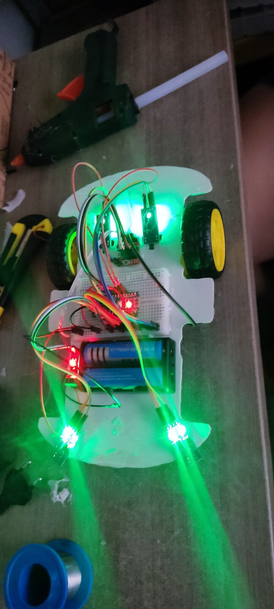

<div align="center">

# 🤖 Gato Móvel

### Um robô que encontra seu caminho seguindo uma linha

Robótica, eletrônica e programação reunidas em um carrinho autônomo construído para aprender fazendo.

[Conheça o projeto](#-o-projeto) · [Monte o circuito](#-ligações-do-programa-principal) · [Execute o código](#-como-executar) · [Explore os experimentos](#-outros-experimentos)

<br>



<sub>Protótipo do Gato Móvel durante a montagem.</sub>

</div>

---

## 🧭 O projeto

O **Gato Móvel** é um carrinho seguidor de linha desenvolvido no contexto da disciplina Projeto Integrador de Engenharia 1 da Universidade de Brasília (UnB). A ideia é transformar uma pista de alto contraste em um caminho que o robô consiga acompanhar sozinho.

O princípio é direto: sensores observam o chão, o Arduino interpreta seus sinais e uma ponte H — circuito que permite comandar os motores — ajusta o movimento das rodas. O repositório reúne o programa principal e diferentes experimentos feitos ao longo do desenvolvimento.

```text
     pista               percepção                 decisão                   movimento
  linha + piso  ───▶  sensores infravermelhos  ───▶  Arduino  ───▶  MX1508  ───▶  motores
```

> **Ponto de partida:** use [`main/main.ino`](main/main.ino) para conhecer a versão principal. Os demais programas são experimentos independentes, com ligações e comportamentos diferentes.

## ⚙️ Como o programa principal funciona

O programa usa três sinais digitais: um sensor central e dois laterais. Os sensores laterais estão ligados a **interrupções**: mudanças no sinal fazem o Arduino executar uma pequena função imediatamente, sem esperar o fim da repetição principal.

| Acontecimento observado pelo programa | Comando enviado aos motores |
|---|---|
| Sensor central em nível alto (`HIGH`) | Motor A e motor B recebem `100` |
| O sinal do sensor direito muda | Motor A recebe `0`; motor B recebe `100` |
| O sinal do sensor esquerdo muda | Motor A recebe `100`; motor B recebe `0` |

Os motores A e B são identificados no código como direito e esquerdo, respectivamente. A direção real depende da montagem e da polaridade dos fios. As interrupções laterais são disparadas em **qualquer mudança** de nível (`CHANGE`), tanto de alto para baixo quanto de baixo para alto; o código não verifica qual foi o novo nível. O laço principal pode voltar a comandar os dois motores enquanto o sensor central estiver em `HIGH`. Por isso, a ordem dos eventos e a resposta dos sensores influenciam o movimento.

**Limitações atuais:** o programa não implementa uma parada específica para perda da linha nem evita obstáculos. Com o sensor central em `LOW` e sem uma nova interrupção lateral, ele não envia um novo comando: permanece o último comando aplicado. O estado inicial dos motores e a resposta aos sensores devem ser verificados na montagem real.

## 🧰 Componentes

Para reproduzir a ideia do programa principal, você precisará de:

| Componente | Função |
|---|---|
| Arduino Uno ou placa compatível com os pinos e interrupções usados | Executa o programa e processa os sinais |
| Três saídas digitais de sensores de linha infravermelhos | Detectam o contraste entre a linha e o piso |
| Módulo MX1508 de ponte H dupla | Comanda os dois motores |
| Dois motores de corrente contínua com rodas | Movimentam o carrinho |
| Chassi, suporte e fios de conexão | Sustentam e conectam os componentes |
| Alimentação adequada à placa, ao módulo e aos motores | Fornece energia ao conjunto |

Os materiais do projeto também descrevem experimentos com sensor de corrente ACS712, sensores de rotação e cartão de memória. Esses itens **não são necessários para o programa principal**.

## 🔌 Ligações do programa principal

As ligações abaixo correspondem exclusivamente a [`main/main.ino`](main/main.ino), tomando o Arduino Uno como referência. Elas são os sinais definidos no código, não um esquema completo de alimentação.

| Arduino Uno | Conexão | Papel no código |
|---|---|---|
| D2 | Saída digital do sensor direito | Interrupção do sensor direito |
| D3 | Saída digital do sensor esquerdo | Interrupção do sensor esquerdo |
| D4 | Saída digital do sensor central | Leitura no laço principal |
| D5 e D6 | Entradas de controle do canal A do MX1508 | Motor A, identificado como direito |
| D9 e D10 | Entradas de controle do canal B do MX1508 | Motor B, identificado como esquerdo |

Conecte cada motor às saídas correspondentes da ponte H e alimente os sensores e o controlador conforme as especificações dos módulos utilizados. Arduino, sensores e controlador de motores precisam compartilhar a mesma referência elétrica, chamada **terra comum** ou `GND`. Confira a tensão, a corrente e a polaridade antes de energizar. Não ligue os motores diretamente aos pinos do Arduino.

Os pinos D2 e D3 são usados porque oferecem interrupções externas no Uno. Se usar outra placa, confira quais pinos têm esse recurso e suporte à **modulação por largura de pulso** (*Pulse Width Modulation*, PWM), usada para controlar a potência enviada aos motores.

## 🚀 Como executar

### 1. Obtenha o projeto

```bash
# Copia o repositório para uma pasta chamada seguidor-linha.
git clone https://github.com/TyrionV8/seguidor-linha.git

# Entra na pasta criada.
cd seguidor-linha
```

### 2. Prepare o ambiente

Instale a [Arduino IDE](https://www.arduino.cc/en/software/) — o ambiente de desenvolvimento do Arduino — e o suporte à placa escolhida. Para o Uno, selecione a família **Arduino AVR Boards** no gerenciador de placas. O programa principal depende da biblioteca [MX1508](libraries/MX1508), já incluída no repositório.

Na Arduino IDE, configure a pasta de *sketchbook* — a pasta de projetos e bibliotecas do Arduino — para a raiz deste repositório nas preferências; assim a IDE pode encontrar a pasta `libraries`. Reinicie a IDE após a alteração. Se preferir, instale a biblioteca MX1508 pelo gerenciador de bibliotecas, caso esteja disponível. Em seguida:

1. Abra [`main/main.ino`](main/main.ino).
2. Em **Ferramentas → Placa**, selecione a placa utilizada; para reproduzir as ligações acima, selecione **Arduino Uno**.
3. Conecte a placa por USB (*Universal Serial Bus*, conexão serial universal) e selecione sua porta em **Ferramentas → Porta**.
4. Clique em **Verificar** para compilar e, depois, em **Carregar** para transferir o programa à placa.
5. Faça o primeiro teste com as rodas suspensas. Observe os sensores e o sentido de cada motor antes de colocar o carrinho na pista.

O programa principal não envia leituras ao Monitor Serial. Para observar valores analógicos dos sensores, consulte o experimento [`ler_sensor_anda`](ler_sensor_anda/ler_sensor_anda.ino), lembrando que ele usa outra pinagem e também aciona os motores.

### Alternativa: compilar pelo terminal

Com a [Arduino CLI](https://arduino.github.io/arduino-cli/) — interface de linha de comando do Arduino — e o suporte `arduino:avr` instalados, execute na raiz do repositório:

```bash
# Compila o programa principal para Arduino Uno.
# --fqbn identifica a placa; --libraries indica as bibliotecas do repositório.
arduino-cli compile --fqbn arduino:avr:uno --libraries libraries main
```

Esse comando verifica e compila o código; ele não transfere o programa para a placa. A transferência pode ser feita pela Arduino IDE após selecionar a porta correta.

## 🎛️ Ajustes e primeiros testes

1. **Prepare a pista.** Use uma linha e um piso com contraste visível. Posicione os sensores próximos ao chão sem que encostem nele.
2. **Confira os sinais.** A saída digital de cada sensor pode variar conforme o módulo e seu ajuste. Verifique quando ela apresenta `HIGH` ou `LOW` sobre a linha e sobre o piso; ajuste a sensibilidade do módulo quando houver essa opção.
3. **Confira os lados.** Com as rodas suspensas, provoque mudanças em cada sensor lateral e observe qual motor recebe cada comando. Revise a fiação e a orientação dos motores se o movimento não corresponder à montagem.
4. **Ajuste a potência.** Em `main/main.ino`, a constante `PWM` começa em `100`, numa escala usual de `0` a `255` no Uno. Trata-se de um comando de potência, não de uma velocidade medida. Altere aos poucos e teste em uma reta antes das curvas.
5. **Teste a pista completa.** Experimente diferentes curvas e condições de iluminação. Se o robô perder a linha, interrompa a alimentação e reposicione-o: o código principal não possui rotina automática de recuperação ou parada.

## 🧪 Outros experimentos

Cada pasta contém um programa separado; abra e compile um de cada vez. A pinagem do programa principal **não** deve ser presumida para os outros.

| Arquivo | O que explora | Atenção |
|---|---|---|
| [`ler_sensor_anda`](ler_sensor_anda/ler_sensor_anda.ino) | Dois sensores analógicos, controle dos motores e leituras pela porta serial | Usa A1/A0 e D6/D7/D5/D4; limiar `150` e pausa de 200 milissegundos |
| [`sensor`](sensor/sensor.ino) | Variante do experimento analógico | Usa uma pausa de 500 milissegundos nas correções |
| [`teste1`](teste1/teste1.ino) | Sensores, contagem de pulsos e tentativa de registro em cartão | Integração experimental; confira hardware, ligações e cálculos antes de usar |
| [`testedavi`](testedavi/testedavi.ino) | Contagem de pulsos de um sensor de rotação | O valor impresso como rotações por segundo é uma contagem de pulsos por intervalo; depende dos pulsos por volta |
| [`leitura_velocidade.ino`](leitura_velocidade.ino/leitura_velocidade.ino.ino) | Outra cópia do teste de contagem de pulsos | O nome da pasta e o nome duplo do arquivo podem exigir ajuste para abertura na Arduino IDE |
| [`sketch_may19a_copy_20240617154131`](sketch_may19a_copy_20240617154131/sketch_may19a_copy_20240617154131.ino) | Testes de entradas, motores e sensor de corrente | A pinagem e a disponibilidade de entradas analógicas dependem da placa |
| [`motor`](motor/motor.ino) | Rascunho de controle e registro de velocidade | Contém trechos incompletos e não está pronto para compilar como está |

Os experimentos analógicos incluem a biblioteca ACS712 mesmo quando não fazem leitura de corrente. A pasta [`libraries`](libraries) também contém SdFat e SPI (*Serial Peripheral Interface*, barramento de comunicação com periféricos), usadas em testes com cartão. As bibliotecas possuem seus próprios arquivos de licença.

## 🗂️ Estrutura do repositório

```text
seguidor-linha/
├── main/                          # programa principal
├── ler_sensor_anda/ e sensor/     # testes com sensores analógicos e motores
├── teste1/ e motor/               # experimentos com registro e velocidade
├── testedavi/                     # teste de contagem de pulsos
├── leitura_velocidade.ino/        # outra cópia do teste de pulsos
├── sketch_may19a_copy_.../        # teste de sensores e corrente
├── libraries/                     # bibliotecas incluídas no repositório
└── docs/imagens/                  # registro visual do protótipo
```

## 🤝 Contribuições

Sugestões e melhorias são bem-vindas. Antes de propor uma alteração, indique qual programa e qual montagem foram usados; se possível, descreva as condições de teste e os resultados observados. Isso ajuda a distinguir uma melhoria de código de um comportamento que depende da pista ou da eletrônica.

O repositório não apresenta uma licença geral para o código do projeto. As bibliotecas de terceiros em `libraries/` mantêm suas respectivas licenças; consulte seus arquivos antes de reutilizá-las.
